# Modelo entidad-relación

El diagrama conceptual oficial está en draw.io (`Diagrama-E-R_modificado.drawio`). Este archivo recoge **los cambios que hay que aplicarle** para que coincida con el modelo relacional y el diccionario, y un diagrama lógico que GitHub dibuja solo.

## Cambios que hay que aplicar al diagrama de draw.io

Salen de la revisión de la profesora del 6 de noviembre (ver el acta) y de las decisiones del equipo del 7 de noviembre.

| # | Cambio | Motivo |
| --- | --- | --- |
| 1 | **Se quita PROGRAMACIÓN.** `hora_inicio`, `hora_fin`, `días_semana` y la vigencia pasan a ser atributos de ASIGNACIÓN. | Profesora |
| 2 | **«pictograma» pasa a llamarse «imagen»** en TAREA, PASO, CLASE y en las entidades nuevas del horario. | Profesora |
| 3 | **TAREA:** se renombra `descripción_pictograma` a `descripción_imagen`; no tiene fecha de creación ni estado. | Profesora |
| 4 | **PASO:** `texto (opcional)` pasa a `descripción (opcional)`, y `descripción_pictograma` a `descripción_imagen`. | Profesora |
| 5 | **Tutor y profesional** se diferencian solo en que el tutor puede personalizar el perfil. La generalización se mantiene para leer el diagrama, pero en la base de datos es un único USUARIO con un atributo `rol`. | Profesora |
| 6 | **Horario escolar (nuevo).** Se añaden FRANJA (la rejilla de horas, común a todo el centro e igual de lunes a viernes) y ASIGNATURA (asignatura o taller). Se relacionan con CLASE mediante la relación ternaria **se imparte**, con el atributo `día_semana`. Cada clase tiene, cada día y en cada franja, una asignatura o taller. | Profesora + equipo |
| 7 | **ESTUDIANTE–CLASE pasa de N:M a N:1**: cada estudiante pertenece a su clase del curso actual. Se quita la nota «una clase por curso escolar». | Equipo (simplificación para la iteración 1) |
| 8 | **PERFIL:** se añade `puede_ocultar_temporizador`, que hace falta para HU-07-01 (RF4.3.1). | Equipo |
| 9 | Lo no comprometido no aparece en el diagrama. | Profesora |
| 10 | **Acceso del estudiante.** Nueva entidad IMAGEN_ACCESO (orden, imagen, descripción_imagen, activa), sin relación con ESTUDIANTE: la combinación de cada uno se guarda con hash en su contraseña. PERFIL gana `método_acceso` (3 imágenes o contraseña de texto). | Equipo (7 nov) |
| 11 | **Lectores de pantalla.** PERFIL gana `usa_lector_pantalla`, porque la web no puede saber si VoiceOver está activo. Toda imagen lleva `descripción_imagen` obligatoria. | Profesora |

## Diagrama lógico

Cada caja es una tabla. `PK` es la clave primaria, `FK` una clave ajena y `UK` un valor único.

```mermaid
erDiagram
  USUARIO ||--o| ESTUDIANTE : "es"
  USUARIO ||--o{ ESTUDIANTE : "tutoriza"
  USUARIO |o--o{ ESTUDIANTE : "es familiar de"
  USUARIO ||--o{ ATENCION : "atiende (profesional)"
  ESTUDIANTE ||--o{ ATENCION : "es atendido"
  CLASE ||--o{ ESTUDIANTE : "pertenece"
  ESTUDIANTE ||--|| PERFIL : "tiene perfil"

  CLASE ||--o{ HORARIO_CLASE : "se imparte"
  FRANJA ||--o{ HORARIO_CLASE : "en"
  ASIGNATURA ||--o{ HORARIO_CLASE : "se imparte"

  USUARIO ||--o{ TAREA : "crea"
  TAREA ||--o{ PASO : "tiene pasos"
  TAREA ||--o{ ASIGNACION : "de"
  ESTUDIANTE ||--o{ ASIGNACION : "recibe"
  USUARIO ||--o{ ASIGNACION : "asigna"
  ASIGNACION ||--o{ EJECUCION : "se ejecuta"
  EJECUCION ||--o{ EJECUCION_PASO : "avanza"
  PASO ||--o{ EJECUCION_PASO : "avanza"

  USUARIO {
    bigint id PK
    varchar usuario_acceso UK
    varchar nombre
    varchar apellidos
    varchar correo
    varchar hash_contrasena
    varchar rol
    boolean activo
    timestamptz fecha_creacion
  }
  ESTUDIANTE {
    bigint usuario_id PK, FK
    varchar codigo_estudiante UK
    varchar avatar
    bigint clase_id FK
    bigint tutor_id FK
    date fecha_alta_tutor
    bigint familiar_id FK
    date fecha_alta_familiar
  }
  CLASE {
    bigint id PK
    varchar nombre
    varchar curso_escolar
    varchar imagen
    varchar descripcion_imagen
  }
  ATENCION {
    bigint id PK
    bigint profesional_id FK
    bigint estudiante_id FK
    date fecha_alta
  }
  PERFIL {
    bigint estudiante_id PK, FK
    varchar tema
    varchar paleta
    varchar tipo_letra
    smallint tamano_letra
    smallint tamano_botones
    varchar posicion_botones
    varchar contenido_botones
    smallint max_tarjetas
    varchar tipo_temporizador
    boolean temporizador_visible
    boolean puede_ocultar_temporizador
    varchar metodo_acceso
    boolean usa_lector_pantalla
  }
  IMAGEN_ACCESO {
    bigint id PK
    smallint orden UK
    varchar imagen
    varchar descripcion_imagen
    boolean activa
  }
  FRANJA {
    bigint id PK
    smallint orden UK
    time hora_inicio
    time hora_fin
  }
  ASIGNATURA {
    bigint id PK
    varchar nombre UK
    varchar tipo
    varchar imagen
    varchar descripcion_imagen
  }
  HORARIO_CLASE {
    bigint id PK
    bigint clase_id FK
    smallint dia_semana
    bigint franja_id FK
    bigint asignatura_id FK
  }
  TAREA {
    bigint id PK
    varchar nombre
    text descripcion
    varchar imagen
    varchar descripcion_imagen
    varchar ambito
    bigint creador_id FK
  }
  PASO {
    bigint id PK
    bigint tarea_id FK
    smallint orden
    varchar imagen
    varchar descripcion_imagen
    text descripcion
  }
  ASIGNACION {
    bigint id PK
    bigint tarea_id FK
    bigint estudiante_id FK
    bigint asignado_por_id FK
    date fecha_asignacion
    time hora_inicio
    time hora_fin
    smallint_array dias_semana
    date vigencia_desde
    date vigencia_hasta
  }
  EJECUCION {
    bigint id PK
    bigint asignacion_id FK
    date fecha
    timestamptz inicio_real
    timestamptz fin_real
    varchar estado
  }
  EJECUCION_PASO {
    bigint id PK
    bigint ejecucion_id FK
    bigint paso_id FK
    varchar estado
  }
```

